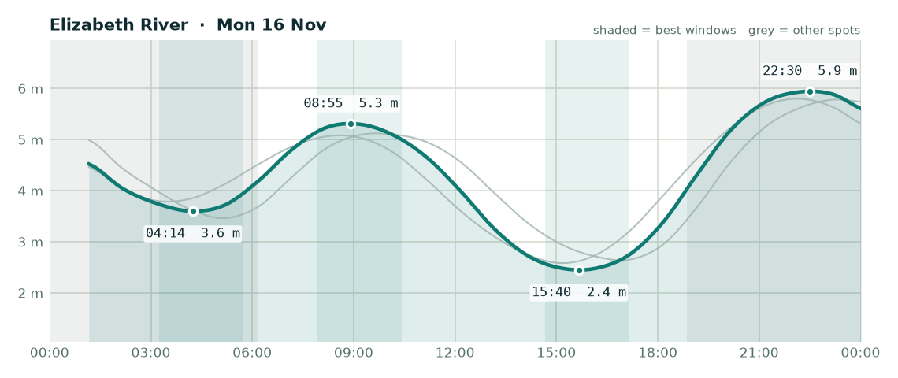

# Fishing outlook - Monday 16 November 2026

**Overall: GOOD**, best bet is **Elizabeth River**.

## Elizabeth River - GOOD (score 4/5)

- **Wind (6am-2pm):** 3 kn SE, gusts to 16 kn
- **Rain:** up to 96% chance
- **Tide:** 3.5 m swing, neap (smaller tide, cleaner water)
- **Changes:** Low 04:14 (3.6 m), High 08:55 (5.3 m), Low 15:40 (2.4 m), High 22:30 (5.9 m)
- **Sun:** up 06:09, down 18:51
- **Best windows:**
  - 03:14-05:44 around the low at 04:14 - lines up with dawn
  - 07:55-10:25 around the high at 08:55
  - 14:40-17:10 around the low at 15:40

## Adelaide River mouth - GOOD (score 4/5)

- **Wind (6am-2pm):** 3 kn E, gusts to 13 kn
- **Rain:** up to 98% chance
- **Tide:** 3.2 m swing, neap (smaller tide, cleaner water)
- **Changes:** Low 05:06 (3.5 m), High 09:43 (5.1 m), Low 16:50 (2.6 m), High 23:26 (5.8 m)
- **Sun:** up 06:09, down 18:50
- **Best windows:**
  - 04:06-06:36 around the low at 05:06 - lines up with dawn
  - 08:43-11:13 around the high at 09:43
  - 15:50-18:20 around the low at 16:50 - lines up with dusk

## Dundee Beach - GOOD (score 4/5)

- **Wind (6am-2pm):** 4 kn SW, gusts to 15 kn
- **Rain:** up to 87% chance
- **Tide:** 3.2 m swing, neap (smaller tide, cleaner water)
- **Changes:** Low 03:31 (3.8 m), High 08:34 (5.1 m), Low 15:10 (2.6 m), High 22:08 (5.8 m)
- **Sun:** up 06:11, down 18:54
- **Best windows:**
  - 07:34-10:04 around the high at 08:34
  - 14:10-16:40 around the low at 15:10

### Tips for today

- Barra: work creek mouths and drains on the run-out after the high, and the first couple of hours of the run-in off the low.
- Jewfish: neaps suit them - fish the slack either side of the change on deeper structure.
- Squid: calm, clean water - worth a look over weed and rock on the morning high.

---
_Tides are modelled (Open-Meteo), not the official BOM tables - times are corrected but can still be ~20-30 min out. Check the BOM tide chart before you launch. Always check current NT Fisheries rules and closures._

**Couldn't fetch:** Weed Reef (Darwin Harbour): <urlopen error _ssl.c:983: The handshake operation timed out>
