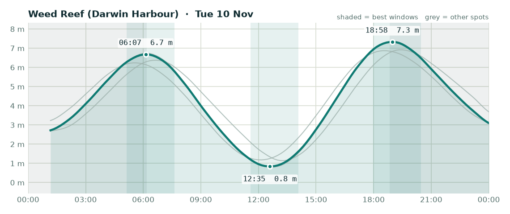

# Fishing outlook - Tuesday 10 November 2026

**Overall: OK**, best bet is **Weed Reef (Darwin Harbour)**.

## Weed Reef (Darwin Harbour) - OK (score 3/5)

- **Wind (6am-2pm):** 3 kn E, gusts to 14 kn
- **Rain:** up to 50% chance
- **Tide:** 6.5 m swing, spring (big tide, strong run, dirtier water)
- **Changes:** High 06:07 (6.7 m), Low 12:35 (0.8 m), High 18:58 (7.3 m)
- **Sun:** up 06:11, down 18:50
- **Best windows:**
  - 05:07-07:37 around the high at 06:07 - lines up with dawn
  - 11:35-14:05 around the low at 12:35
  - 17:58-20:28 around the high at 18:58 - lines up with dusk

## Adelaide River mouth - OK (score 3/5)

- **Wind (6am-2pm):** 4 kn E, gusts to 18 kn
- **Rain:** up to 43% chance
- **Tide:** 5.8 m swing, spring (big tide, strong run, dirtier water)
- **Changes:** High 06:38 (6.4 m), Low 13:15 (1.1 m), High 19:28 (6.9 m)
- **Sun:** up 06:09, down 18:47
- **Best windows:**
  - 05:38-08:08 around the high at 06:38 - lines up with dawn
  - 12:15-14:45 around the low at 13:15
  - 18:28-20:58 around the high at 19:28 - lines up with dusk

## Elizabeth River - OK (score 2/5)

- **Wind (6am-2pm):** 2 kn E, gusts to 12 kn
- **Rain:** up to 76% chance
- **Tide:** 6.6 m swing, spring (big tide, strong run, dirtier water)
- **Changes:** High 06:09 (6.7 m), Low 12:39 (0.8 m), High 18:59 (7.4 m)
- **Sun:** up 06:10, down 18:49
- **Best windows:**
  - 05:09-07:39 around the high at 06:09 - lines up with dawn
  - 11:39-14:09 around the low at 12:39
  - 17:59-20:29 around the high at 18:59 - lines up with dusk

## Dundee Beach - OK (score 2/5)

- **Wind (6am-2pm):** 3 kn SW, gusts to 19 kn
- **Rain:** up to 94% chance
- **Tide:** 5.7 m swing, spring (big tide, strong run, dirtier water)
- **Changes:** High 05:34 (6.2 m), Low 12:06 (1.2 m), High 18:35 (6.9 m)
- **Sun:** up 06:12, down 18:52
- **Best windows:**
  - 04:34-07:04 around the high at 05:34 - lines up with dawn
  - 11:06-13:36 around the low at 12:06
  - 17:35-20:05 around the high at 18:35 - lines up with dusk

### Tips for today

- Barra: work creek mouths and drains on the run-out after the high, and the first couple of hours of the run-in off the low.
- Jewfish: bigger tide today - the short slack at each change is your best shot.
- Squid: wind or tide will stir the water up - probably not the day.

---
_Tides are modelled (Open-Meteo), not the official BOM tables - times are corrected but can still be ~20-30 min out. Check the BOM tide chart before you launch. Always check current NT Fisheries rules and closures._
