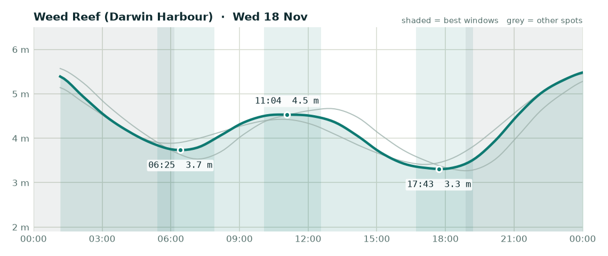

# Fishing outlook - Wednesday 18 November 2026

**Overall: GOOD**, best bet is **Weed Reef (Darwin Harbour)**.

## Weed Reef (Darwin Harbour) - GOOD (score 5/5)

- **Wind (6am-2pm):** 5 kn NE, gusts to 14 kn
- **Rain:** up to 20% chance
- **Tide:** 1.2 m swing, neap (smaller tide, cleaner water)
- **Changes:** Low 06:25 (3.7 m), High 11:04 (4.5 m), Low 17:43 (3.3 m)
- **Sun:** up 06:10, down 18:53
- **Best windows:**
  - 05:25-07:55 around the low at 06:25 - lines up with dawn
  - 10:04-12:34 around the high at 11:04
  - 16:43-19:13 around the low at 17:43 - lines up with dusk

## Elizabeth River - GOOD (score 5/5)

- **Wind (6am-2pm):** 3 kn SE, gusts to 12 kn
- **Rain:** up to 57% chance
- **Tide:** 1.2 m swing, neap (smaller tide, cleaner water)
- **Changes:** Low 06:28 (3.7 m), High 11:00 (4.5 m), Low 17:43 (3.3 m)
- **Sun:** up 06:09, down 18:52
- **Best windows:**
  - 05:28-07:58 around the low at 06:28 - lines up with dawn
  - 10:00-12:30 around the high at 11:00
  - 16:43-19:13 around the low at 17:43 - lines up with dusk

## Adelaide River mouth - GOOD (score 5/5)

- **Wind (6am-2pm):** 4 kn E, gusts to 15 kn
- **Rain:** up to 27% chance
- **Tide:** 1.4 m swing, neap (smaller tide, cleaner water)
- **Changes:** Low 07:10 (3.5 m), High 12:48 (4.7 m), Low 18:48 (3.3 m)
- **Sun:** up 06:09, down 18:51
- **Best windows:**
  - 06:10-08:40 around the low at 07:10 - lines up with dawn
  - 11:48-14:18 around the high at 12:48
  - 17:48-20:18 around the low at 18:48 - lines up with dusk

## Dundee Beach - GOOD (score 4/5)

- **Wind (6am-2pm):** 4 kn S, gusts to 16 kn
- **Rain:** up to 61% chance
- **Tide:** 1.0 m swing, neap (smaller tide, cleaner water)
- **Changes:** Low 05:57 (3.9 m), High 10:49 (4.4 m), Low 17:03 (3.4 m)
- **Sun:** up 06:11, down 18:55
- **Best windows:**
  - 04:57-07:27 around the low at 05:57 - lines up with dawn
  - 09:49-12:19 around the high at 10:49
  - 16:03-18:33 around the low at 17:03 - lines up with dusk

### Tips for today

- Barra: work creek mouths and drains on the run-out after the high, and the first couple of hours of the run-in off the low.
- Jewfish: neaps suit them - fish the slack either side of the change on deeper structure.
- Squid: calm, clean water - worth a look over weed and rock on the morning high.

---
_Tides are modelled (Open-Meteo), not the official BOM tables - times are corrected but can still be ~20-30 min out. Check the BOM tide chart before you launch. Always check current NT Fisheries rules and closures._
