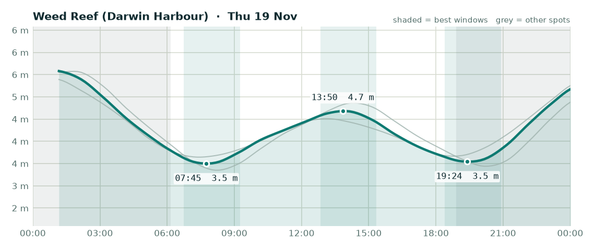

# Fishing outlook - Thursday 19 November 2026

**Overall: GOOD**, best bet is **Weed Reef (Darwin Harbour)**.

## Weed Reef (Darwin Harbour) - GOOD (score 4/5)

- **Wind (6am-2pm):** 4 kn E, gusts to 14 kn
- **Rain:** up to 95% chance
- **Tide:** 1.2 m swing, neap (smaller tide, cleaner water)
- **Changes:** Low 07:45 (3.5 m), High 13:50 (4.7 m), Low 19:24 (3.5 m)
- **Sun:** up 06:10, down 18:54
- **Best windows:**
  - 06:45-09:15 around the low at 07:45 - lines up with dawn
  - 12:50-15:20 around the high at 13:50
  - 18:24-20:54 around the low at 19:24 - lines up with dusk

## Elizabeth River - GOOD (score 4/5)

- **Wind (6am-2pm):** 2 kn E, gusts to 12 kn
- **Rain:** up to 100% chance
- **Tide:** 1.2 m swing, neap (smaller tide, cleaner water)
- **Changes:** Low 07:46 (3.5 m), High 13:53 (4.7 m), Low 19:29 (3.5 m)
- **Sun:** up 06:09, down 18:53
- **Best windows:**
  - 06:46-09:16 around the low at 07:46 - lines up with dawn
  - 12:53-15:23 around the high at 13:53
  - 18:29-20:59 around the low at 19:29 - lines up with dusk

## Adelaide River mouth - GOOD (score 4/5)

- **Wind (6am-2pm):** 3 kn NE, gusts to 14 kn
- **Rain:** up to 97% chance
- **Tide:** 2.2 m swing, neap (smaller tide, cleaner water)
- **Changes:** High 01:40 (5.6 m), Low 08:14 (3.3 m), High 14:20 (4.9 m), Low 20:13 (3.4 m)
- **Sun:** up 06:09, down 18:51
- **Best windows:**
  - 07:14-09:44 around the low at 08:14
  - 13:20-15:50 around the high at 14:20
  - 19:13-21:43 around the low at 20:13 - lines up with dusk

## Dundee Beach - GOOD (score 4/5)

- **Wind (6am-2pm):** 4 kn SE, gusts to 16 kn
- **Rain:** up to 100% chance
- **Tide:** 0.9 m swing, neap (smaller tide, cleaner water)
- **Changes:** Low 07:28 (3.6 m), High 13:08 (4.5 m), Low 18:46 (3.7 m)
- **Sun:** up 06:11, down 18:55
- **Best windows:**
  - 06:28-08:58 around the low at 07:28 - lines up with dawn
  - 12:08-14:38 around the high at 13:08
  - 17:46-20:16 around the low at 18:46 - lines up with dusk

### Tips for today

- Barra: work creek mouths and drains on the run-out after the high, and the first couple of hours of the run-in off the low.
- Jewfish: neaps suit them - fish the slack either side of the change on deeper structure.
- Squid: calm, clean water - worth a look over weed and rock on the morning high.

---
_Tides are modelled (Open-Meteo), not the official BOM tables - times are corrected but can still be ~20-30 min out. Check the BOM tide chart before you launch. Always check current NT Fisheries rules and closures._
