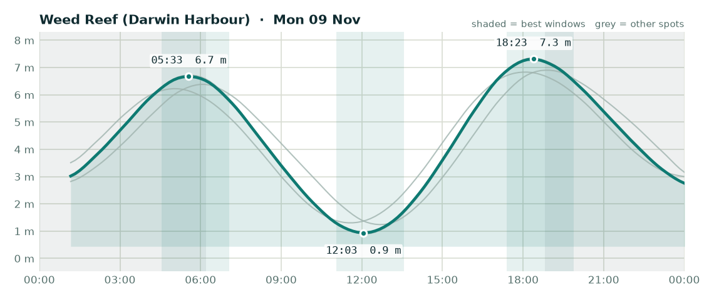

# Fishing outlook - Monday 09 November 2026

**Overall: OK**, best bet is **Weed Reef (Darwin Harbour)**.

## Weed Reef (Darwin Harbour) - OK (score 3/5)

- **Wind (6am-2pm):** 4 kn E, gusts to 17 kn
- **Rain:** up to 51% chance
- **Tide:** 6.4 m swing, spring (big tide, strong run, dirtier water)
- **Changes:** High 05:33 (6.7 m), Low 12:03 (0.9 m), High 18:23 (7.3 m)
- **Sun:** up 06:12, down 18:49
- **Best windows:**
  - 04:33-07:03 around the high at 05:33 - lines up with dawn
  - 11:03-13:33 around the low at 12:03
  - 17:23-19:53 around the high at 18:23 - lines up with dusk

## Elizabeth River - OK (score 3/5)

- **Wind (6am-2pm):** 4 kn E, gusts to 17 kn
- **Rain:** up to 51% chance
- **Tide:** 6.5 m swing, spring (big tide, strong run, dirtier water)
- **Changes:** High 05:35 (6.7 m), Low 12:05 (0.9 m), High 18:23 (7.4 m)
- **Sun:** up 06:10, down 18:48
- **Best windows:**
  - 04:35-07:05 around the high at 05:35 - lines up with dawn
  - 11:05-13:35 around the low at 12:05
  - 17:23-19:53 around the high at 18:23 - lines up with dusk

## Adelaide River mouth - OK (score 3/5)

- **Wind (6am-2pm):** 5 kn E, gusts to 16 kn
- **Rain:** up to 16% chance
- **Tide:** 5.7 m swing, spring (big tide, strong run, dirtier water)
- **Changes:** High 06:04 (6.4 m), Low 12:40 (1.2 m), High 18:55 (6.9 m)
- **Sun:** up 06:10, down 18:47
- **Best windows:**
  - 05:04-07:34 around the high at 06:04 - lines up with dawn
  - 11:40-14:10 around the low at 12:40
  - 17:55-20:25 around the high at 18:55 - lines up with dusk

## Dundee Beach - OK (score 2/5)

- **Wind (6am-2pm):** 4 kn SE, gusts to 17 kn
- **Rain:** up to 80% chance
- **Tide:** 5.5 m swing, spring (big tide, strong run, dirtier water)
- **Changes:** High 05:02 (6.2 m), Low 11:34 (1.3 m), High 18:06 (6.8 m)
- **Sun:** up 06:13, down 18:51
- **Best windows:**
  - 04:02-06:32 around the high at 05:02 - lines up with dawn
  - 10:34-13:04 around the low at 11:34
  - 17:06-19:36 around the high at 18:06 - lines up with dusk

### Tips for today

- Barra: work creek mouths and drains on the run-out after the high, and the first couple of hours of the run-in off the low.
- Jewfish: bigger tide today - the short slack at each change is your best shot.
- Squid: wind or tide will stir the water up - probably not the day.

---
_Tides are modelled (Open-Meteo), not the official BOM tables - times are corrected but can still be ~20-30 min out. Check the BOM tide chart before you launch. Always check current NT Fisheries rules and closures._
