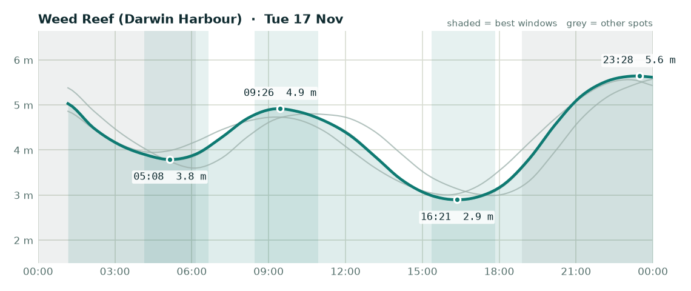

# Fishing outlook - Tuesday 17 November 2026

**Overall: GOOD**, best bet is **Weed Reef (Darwin Harbour)**.

## Weed Reef (Darwin Harbour) - GOOD (score 4/5)

- **Wind (6am-2pm):** 4 kn NE, gusts to 12 kn
- **Rain:** up to 100% chance
- **Tide:** 2.7 m swing, neap (smaller tide, cleaner water)
- **Changes:** Low 05:08 (3.8 m), High 09:26 (4.9 m), Low 16:21 (2.9 m), High 23:28 (5.6 m)
- **Sun:** up 06:10, down 18:53
- **Best windows:**
  - 04:08-06:38 around the low at 05:08 - lines up with dawn
  - 08:26-10:56 around the high at 09:26
  - 15:21-17:51 around the low at 16:21

## Elizabeth River - GOOD (score 4/5)

- **Wind (6am-2pm):** 3 kn SE, gusts to 18 kn
- **Rain:** up to 100% chance
- **Tide:** 2.8 m swing, neap (smaller tide, cleaner water)
- **Changes:** Low 05:11 (3.8 m), High 09:25 (4.9 m), Low 16:22 (2.9 m), High 23:35 (5.6 m)
- **Sun:** up 06:09, down 18:52
- **Best windows:**
  - 04:11-06:41 around the low at 05:11 - lines up with dawn
  - 08:25-10:55 around the high at 09:25
  - 15:22-17:52 around the low at 16:22

## Adelaide River mouth - GOOD (score 4/5)

- **Wind (6am-2pm):** 3 kn SE, gusts to 16 kn
- **Rain:** up to 100% chance
- **Tide:** 1.8 m swing, neap (smaller tide, cleaner water)
- **Changes:** Low 06:03 (3.6 m), High 10:40 (4.8 m), Low 17:40 (3.0 m)
- **Sun:** up 06:09, down 18:50
- **Best windows:**
  - 05:03-07:33 around the low at 06:03 - lines up with dawn
  - 09:40-12:10 around the high at 10:40
  - 16:40-19:10 around the low at 17:40 - lines up with dusk

## Dundee Beach - GOOD (score 4/5)

- **Wind (6am-2pm):** 4 kn S, gusts to 16 kn
- **Rain:** up to 98% chance
- **Tide:** 2.6 m swing, neap (smaller tide, cleaner water)
- **Changes:** Low 04:31 (3.9 m), High 09:16 (4.7 m), Low 15:54 (3.0 m), High 23:02 (5.6 m)
- **Sun:** up 06:11, down 18:54
- **Best windows:**
  - 03:31-06:01 around the low at 04:31 - lines up with dawn
  - 08:16-10:46 around the high at 09:16
  - 14:54-17:24 around the low at 15:54

### Tips for today

- Barra: work creek mouths and drains on the run-out after the high, and the first couple of hours of the run-in off the low.
- Jewfish: neaps suit them - fish the slack either side of the change on deeper structure.
- Squid: calm, clean water - worth a look over weed and rock on the morning high.

---
_Tides are modelled (Open-Meteo), not the official BOM tables - times are corrected but can still be ~20-30 min out. Check the BOM tide chart before you launch. Always check current NT Fisheries rules and closures._
