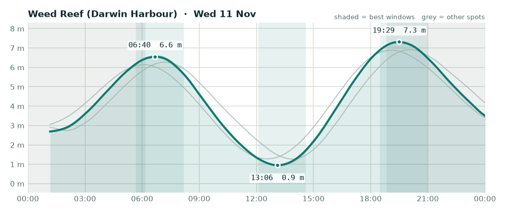

# Fishing outlook - Wednesday 11 November 2026

**Overall: OK**, best bet is **Weed Reef (Darwin Harbour)**.

## Weed Reef (Darwin Harbour) - OK (score 3/5)

- **Wind (6am-2pm):** 6 kn NE, gusts to 19 kn
- **Rain:** up to 48% chance
- **Tide:** 6.4 m swing, spring (big tide, strong run, dirtier water)
- **Changes:** High 06:40 (6.6 m), Low 13:06 (0.9 m), High 19:29 (7.3 m)
- **Sun:** up 06:11, down 18:50
- **Best windows:**
  - 05:40-08:10 around the high at 06:40 - lines up with dawn
  - 12:06-14:36 around the low at 13:06
  - 18:29-20:59 around the high at 19:29 - lines up with dusk

## Elizabeth River - OK (score 3/5)

- **Wind (6am-2pm):** 6 kn NE, gusts to 17 kn
- **Rain:** up to 31% chance
- **Tide:** 6.4 m swing, spring (big tide, strong run, dirtier water)
- **Changes:** High 06:42 (6.6 m), Low 13:09 (0.9 m), High 19:30 (7.3 m)
- **Sun:** up 06:10, down 18:49
- **Best windows:**
  - 05:42-08:12 around the high at 06:42 - lines up with dawn
  - 12:09-14:39 around the low at 13:09
  - 18:30-21:00 around the high at 19:30 - lines up with dusk

## Adelaide River mouth - OK (score 3/5)

- **Wind (6am-2pm):** 7 kn NE, gusts to 20 kn
- **Rain:** up to 41% chance
- **Tide:** 5.7 m swing, spring (big tide, strong run, dirtier water)
- **Changes:** Low 01:54 (2.7 m), High 07:10 (6.3 m), Low 13:52 (1.3 m), High 20:04 (6.9 m)
- **Sun:** up 06:09, down 18:48
- **Best windows:**
  - 06:10-08:40 around the high at 07:10 - lines up with dawn
  - 12:52-15:22 around the low at 13:52
  - 19:04-21:34 around the high at 20:04 - lines up with dusk

## Dundee Beach - OK (score 2/5)

- **Wind (6am-2pm):** 5 kn E, gusts to 17 kn
- **Rain:** up to 73% chance
- **Tide:** 5.6 m swing, spring (big tide, strong run, dirtier water)
- **Changes:** High 06:05 (6.1 m), Low 12:32 (1.3 m), High 19:06 (6.9 m)
- **Sun:** up 06:12, down 18:52
- **Best windows:**
  - 05:05-07:35 around the high at 06:05 - lines up with dawn
  - 11:32-14:02 around the low at 12:32
  - 18:06-20:36 around the high at 19:06 - lines up with dusk

### Tips for today

- Barra: work creek mouths and drains on the run-out after the high, and the first couple of hours of the run-in off the low.
- Jewfish: bigger tide today - the short slack at each change is your best shot.
- Squid: wind or tide will stir the water up - probably not the day.

---
_Tides are modelled (Open-Meteo), not the official BOM tables - times are corrected but can still be ~20-30 min out. Check the BOM tide chart before you launch. Always check current NT Fisheries rules and closures._
