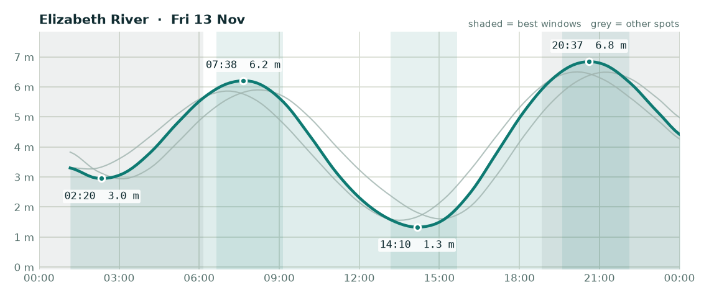

# Fishing outlook - Friday 13 November 2026

**Overall: OK**, best bet is **Elizabeth River**.

## Elizabeth River - OK (score 3/5)

- **Wind (6am-2pm):** 3 kn SE, gusts to 15 kn
- **Rain:** up to 53% chance
- **Tide:** 5.5 m swing, spring (big tide, strong run, dirtier water)
- **Changes:** Low 02:20 (3.0 m), High 07:38 (6.2 m), Low 14:10 (1.3 m), High 20:37 (6.8 m)
- **Sun:** up 06:10, down 18:50
- **Best windows:**
  - 06:38-09:08 around the high at 07:38 - lines up with dawn
  - 13:10-15:40 around the low at 14:10
  - 19:37-22:07 around the high at 20:37 - lines up with dusk

## Adelaide River mouth - OK (score 3/5)

- **Wind (6am-2pm):** 4 kn E, gusts to 16 kn
- **Rain:** up to 53% chance
- **Tide:** 4.9 m swing, spring (big tide, strong run, dirtier water)
- **Changes:** Low 03:05 (2.9 m), High 08:12 (5.9 m), Low 15:00 (1.6 m), High 21:14 (6.5 m)
- **Sun:** up 06:09, down 18:49
- **Best windows:**
  - 07:12-09:42 around the high at 08:12
  - 14:00-16:30 around the low at 15:00

## Dundee Beach - OK (score 2/5)

- **Wind (6am-2pm):** 3 kn S, gusts to 18 kn
- **Rain:** up to 95% chance
- **Tide:** 4.9 m swing, spring (big tide, strong run, dirtier water)
- **Changes:** Low 01:42 (3.2 m), High 07:03 (5.9 m), Low 13:30 (1.6 m), High 20:10 (6.5 m)
- **Sun:** up 06:12, down 18:53
- **Best windows:**
  - 06:03-08:33 around the high at 07:03 - lines up with dawn
  - 12:30-15:00 around the low at 13:30
  - 19:10-21:40 around the high at 20:10 - lines up with dusk

### Tips for today

- Barra: work creek mouths and drains on the run-out after the high, and the first couple of hours of the run-in off the low.
- Jewfish: bigger tide today - the short slack at each change is your best shot.
- Squid: wind or tide will stir the water up - probably not the day.

---
_Tides are modelled (Open-Meteo), not the official BOM tables - times are corrected but can still be ~20-30 min out. Check the BOM tide chart before you launch. Always check current NT Fisheries rules and closures._

**Couldn't fetch:** Weed Reef (Darwin Harbour): <urlopen error _ssl.c:983: The handshake operation timed out>
