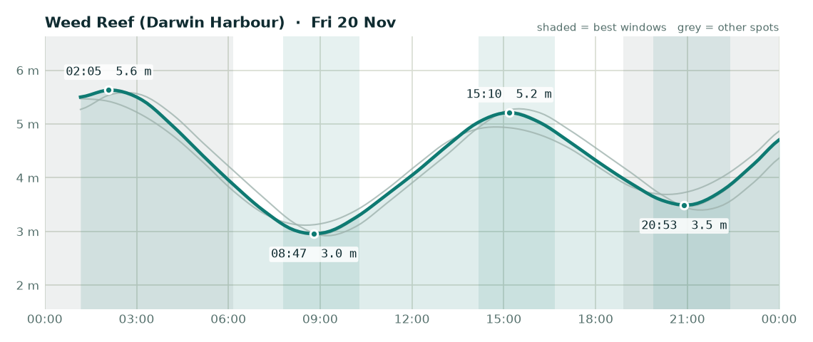

# Fishing outlook - Friday 20 November 2026

**Overall: GOOD**, best bet is **Weed Reef (Darwin Harbour)**.

## Weed Reef (Darwin Harbour) - GOOD (score 4/5)

- **Wind (6am-2pm):** 3 kn S, gusts to 15 kn
- **Rain:** up to 96% chance
- **Tide:** 2.7 m swing, neap (smaller tide, cleaner water)
- **Changes:** High 02:05 (5.6 m), Low 08:47 (3.0 m), High 15:10 (5.2 m), Low 20:53 (3.5 m)
- **Sun:** up 06:10, down 18:54
- **Best windows:**
  - 07:47-10:17 around the low at 08:47
  - 14:10-16:40 around the high at 15:10
  - 19:53-22:23 around the low at 20:53 - lines up with dusk

## Elizabeth River - GOOD (score 4/5)

- **Wind (6am-2pm):** 2 kn SE, gusts to 12 kn
- **Rain:** up to 93% chance
- **Tide:** 2.7 m swing, neap (smaller tide, cleaner water)
- **Changes:** High 02:07 (5.7 m), Low 08:50 (2.9 m), High 15:11 (5.2 m), Low 20:56 (3.5 m)
- **Sun:** up 06:09, down 18:53
- **Best windows:**
  - 07:50-10:20 around the low at 08:50
  - 14:11-16:41 around the high at 15:11

## Adelaide River mouth - GOOD (score 4/5)

- **Wind (6am-2pm):** 2 kn SE, gusts to 12 kn
- **Rain:** up to 100% chance
- **Tide:** 2.7 m swing, neap (smaller tide, cleaner water)
- **Changes:** High 02:37 (5.6 m), Low 09:14 (2.9 m), High 15:32 (5.3 m), Low 21:26 (3.4 m)
- **Sun:** up 06:09, down 18:52
- **Best windows:**
  - 08:14-10:44 around the low at 09:14
  - 14:32-17:02 around the high at 15:32

## Dundee Beach - GOOD (score 4/5)

- **Wind (6am-2pm):** 4 kn S, gusts to 20 kn
- **Rain:** up to 93% chance
- **Tide:** 1.8 m swing, neap (smaller tide, cleaner water)
- **Changes:** Low 08:32 (3.1 m), High 14:48 (4.9 m), Low 20:20 (3.7 m)
- **Sun:** up 06:11, down 18:56
- **Best windows:**
  - 07:32-10:02 around the low at 08:32
  - 13:48-16:18 around the high at 14:48
  - 19:20-21:50 around the low at 20:20 - lines up with dusk

### Tips for today

- Barra: work creek mouths and drains on the run-out after the high, and the first couple of hours of the run-in off the low.
- Jewfish: neaps suit them - fish the slack either side of the change on deeper structure.
- Squid: calm, clean water - worth a look over weed and rock on the morning high.

---
_Tides are modelled (Open-Meteo), not the official BOM tables - times are corrected but can still be ~20-30 min out. Check the BOM tide chart before you launch. Always check current NT Fisheries rules and closures._
