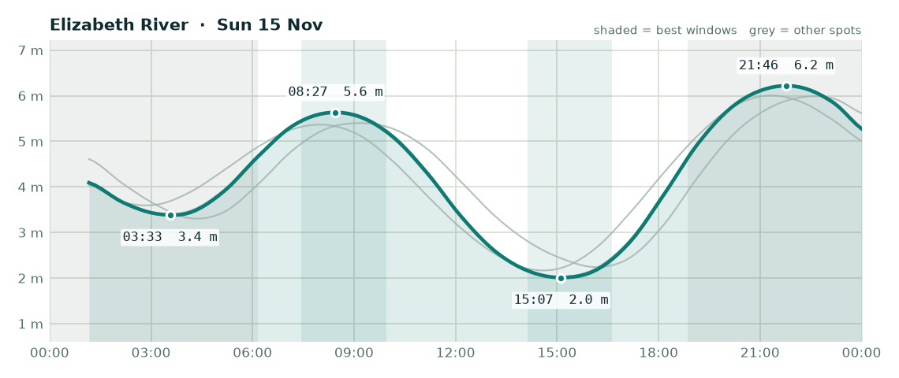

# Fishing outlook - Sunday 15 November 2026

**Overall: OK**, best bet is **Elizabeth River**.

## Elizabeth River - OK (score 3/5)

- **Wind (6am-2pm):** 3 kn SW, gusts to 13 kn
- **Rain:** up to 93% chance
- **Tide:** 4.2 m swing, middling
- **Changes:** Low 03:33 (3.4 m), High 08:27 (5.6 m), Low 15:07 (2.0 m), High 21:46 (6.2 m)
- **Sun:** up 06:09, down 18:51
- **Best windows:**
  - 07:27-09:57 around the high at 08:27
  - 14:07-16:37 around the low at 15:07

## Adelaide River mouth - OK (score 3/5)

- **Wind (6am-2pm):** 3 kn W, gusts to 14 kn
- **Rain:** up to 99% chance
- **Tide:** 3.7 m swing, middling
- **Changes:** Low 04:20 (3.3 m), High 09:10 (5.4 m), Low 16:07 (2.2 m), High 22:35 (6.0 m)
- **Sun:** up 06:09, down 18:49
- **Best windows:**
  - 03:20-05:50 around the low at 04:20 - lines up with dawn
  - 08:10-10:40 around the high at 09:10
  - 15:07-17:37 around the low at 16:07

## Weed Reef (Darwin Harbour) - OK (score 2/5)

- **Wind (6am-2pm):** 3 kn W, gusts to 12 kn
- **Rain:** up to 88% chance
- **Tide:** 4.2 m swing, spring (big tide, strong run, dirtier water)
- **Changes:** Low 03:28 (3.4 m), High 08:25 (5.6 m), Low 15:03 (2.0 m), High 21:43 (6.2 m)
- **Sun:** up 06:11, down 18:52
- **Best windows:**
  - 07:25-09:55 around the high at 08:25
  - 14:03-16:33 around the low at 15:03

## Dundee Beach - OK (score 2/5)

- **Wind (6am-2pm):** 3 kn SW, gusts to 14 kn
- **Rain:** up to 91% chance
- **Tide:** 3.8 m swing, spring (big tide, strong run, dirtier water)
- **Changes:** Low 02:50 (3.6 m), High 07:58 (5.4 m), Low 14:35 (2.2 m), High 21:21 (6.0 m)
- **Sun:** up 06:12, down 18:54
- **Best windows:**
  - 06:58-09:28 around the high at 07:58 - lines up with dawn
  - 13:35-16:05 around the low at 14:35

### Tips for today

- Barra: work creek mouths and drains on the run-out after the high, and the first couple of hours of the run-in off the low.
- Jewfish: bigger tide today - the short slack at each change is your best shot.
- Squid: wind or tide will stir the water up - probably not the day.

---
_Tides are modelled (Open-Meteo), not the official BOM tables - times are corrected but can still be ~20-30 min out. Check the BOM tide chart before you launch. Always check current NT Fisheries rules and closures._
