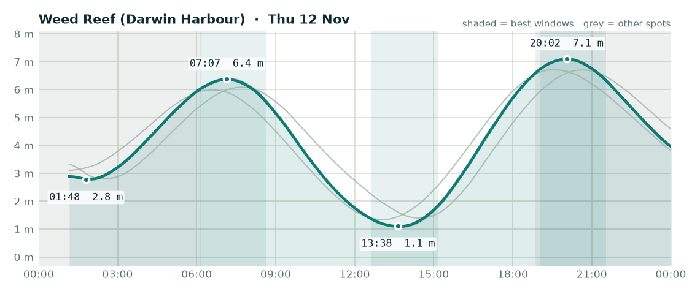

# Fishing outlook - Thursday 12 November 2026

**Overall: OK**, best bet is **Weed Reef (Darwin Harbour)**.

## Weed Reef (Darwin Harbour) - OK (score 2/5)

- **Wind (6am-2pm):** 5 kn SE, gusts to 16 kn
- **Rain:** up to 64% chance
- **Tide:** 6.0 m swing, spring (big tide, strong run, dirtier water)
- **Changes:** Low 01:48 (2.8 m), High 07:07 (6.4 m), Low 13:38 (1.1 m), High 20:02 (7.1 m)
- **Sun:** up 06:11, down 18:51
- **Best windows:**
  - 06:07-08:37 around the high at 07:07 - lines up with dawn
  - 12:38-15:08 around the low at 13:38
  - 19:02-21:32 around the high at 20:02 - lines up with dusk

## Elizabeth River - OK (score 2/5)

- **Wind (6am-2pm):** 5 kn SE, gusts to 15 kn
- **Rain:** up to 63% chance
- **Tide:** 6.1 m swing, spring (big tide, strong run, dirtier water)
- **Changes:** Low 01:50 (2.7 m), High 07:09 (6.4 m), Low 13:42 (1.0 m), High 20:04 (7.1 m)
- **Sun:** up 06:10, down 18:50
- **Best windows:**
  - 06:09-08:39 around the high at 07:09 - lines up with dawn
  - 12:42-15:12 around the low at 13:42
  - 19:04-21:34 around the high at 20:04 - lines up with dusk

## Adelaide River mouth - OK (score 2/5)

- **Wind (6am-2pm):** 5 kn SE, gusts to 17 kn
- **Rain:** up to 82% chance
- **Tide:** 5.3 m swing, spring (big tide, strong run, dirtier water)
- **Changes:** Low 02:29 (2.8 m), High 07:42 (6.1 m), Low 14:26 (1.4 m), High 20:39 (6.7 m)
- **Sun:** up 06:09, down 18:48
- **Best windows:**
  - 06:42-09:12 around the high at 07:42 - lines up with dawn
  - 13:26-15:56 around the low at 14:26
  - 19:39-22:09 around the high at 20:39 - lines up with dusk

## Dundee Beach - OK (score 2/5)

- **Wind (6am-2pm):** 4 kn S, gusts to 18 kn
- **Rain:** up to 62% chance
- **Tide:** 5.4 m swing, spring (big tide, strong run, dirtier water)
- **Changes:** High 06:35 (6.0 m), Low 13:02 (1.3 m), High 19:35 (6.7 m)
- **Sun:** up 06:12, down 18:52
- **Best windows:**
  - 05:35-08:05 around the high at 06:35 - lines up with dawn
  - 12:02-14:32 around the low at 13:02
  - 18:35-21:05 around the high at 19:35 - lines up with dusk

### Tips for today

- Barra: work creek mouths and drains on the run-out after the high, and the first couple of hours of the run-in off the low.
- Jewfish: bigger tide today - the short slack at each change is your best shot.
- Squid: wind or tide will stir the water up - probably not the day.

---
_Tides are modelled (Open-Meteo), not the official BOM tables - times are corrected but can still be ~20-30 min out. Check the BOM tide chart before you launch. Always check current NT Fisheries rules and closures._
