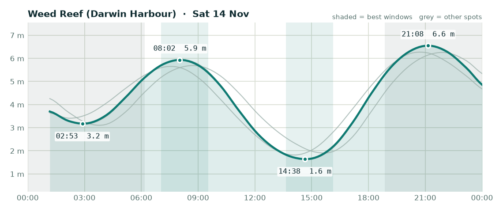

# Fishing outlook - Saturday 14 November 2026

**Overall: OK**, best bet is **Weed Reef (Darwin Harbour)**.

## Weed Reef (Darwin Harbour) - OK (score 2/5)

- **Wind (6am-2pm):** 3 kn S, gusts to 13 kn
- **Rain:** up to 93% chance
- **Tide:** 4.9 m swing, spring (big tide, strong run, dirtier water)
- **Changes:** Low 02:53 (3.2 m), High 08:02 (5.9 m), Low 14:38 (1.6 m), High 21:08 (6.6 m)
- **Sun:** up 06:11, down 18:51
- **Best windows:**
  - 07:02-09:32 around the high at 08:02 - lines up with dawn
  - 13:38-16:08 around the low at 14:38

## Elizabeth River - OK (score 2/5)

- **Wind (6am-2pm):** 4 kn S, gusts to 13 kn
- **Rain:** up to 90% chance
- **Tide:** 4.9 m swing, spring (big tide, strong run, dirtier water)
- **Changes:** Low 02:56 (3.1 m), High 08:03 (6.0 m), Low 14:42 (1.6 m), High 21:10 (6.6 m)
- **Sun:** up 06:09, down 18:50
- **Best windows:**
  - 07:03-09:33 around the high at 08:03 - lines up with dawn
  - 13:42-16:12 around the low at 14:42

## Adelaide River mouth - OK (score 2/5)

- **Wind (6am-2pm):** 4 kn E, gusts to 15 kn
- **Rain:** up to 100% chance
- **Tide:** 4.3 m swing, spring (big tide, strong run, dirtier water)
- **Changes:** Low 03:44 (3.1 m), High 08:42 (5.7 m), Low 15:35 (1.9 m), High 21:52 (6.3 m)
- **Sun:** up 06:09, down 18:49
- **Best windows:**
  - 02:44-05:14 around the low at 03:44
  - 07:42-10:12 around the high at 08:42
  - 14:35-17:05 around the low at 15:35

## Dundee Beach - OK (score 2/5)

- **Wind (6am-2pm):** 4 kn SW, gusts to 17 kn
- **Rain:** up to 94% chance
- **Tide:** 4.5 m swing, spring (big tide, strong run, dirtier water)
- **Changes:** Low 02:14 (3.4 m), High 07:32 (5.6 m), Low 14:03 (1.8 m), High 20:44 (6.3 m)
- **Sun:** up 06:12, down 18:53
- **Best windows:**
  - 06:32-09:02 around the high at 07:32 - lines up with dawn
  - 13:03-15:33 around the low at 14:03
  - 19:44-22:14 around the high at 20:44 - lines up with dusk

### Tips for today

- Barra: work creek mouths and drains on the run-out after the high, and the first couple of hours of the run-in off the low.
- Jewfish: bigger tide today - the short slack at each change is your best shot.
- Squid: wind or tide will stir the water up - probably not the day.

---
_Tides are modelled (Open-Meteo), not the official BOM tables - times are corrected but can still be ~20-30 min out. Check the BOM tide chart before you launch. Always check current NT Fisheries rules and closures._
